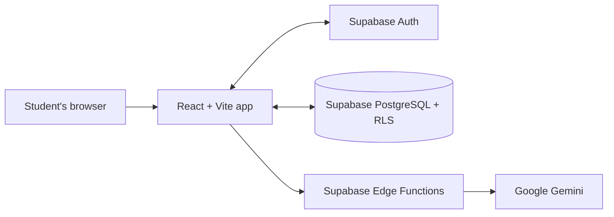

# MyStudyBuddy

MyStudyBuddy is a personal study tracker that helps students organize subjects and topics, plan work around deadlines, record focused study time, and use AI tools to turn notes into revision material. It is a React single-page application backed by Supabase, with Google Gemini requests handled by Supabase Edge Functions.

## Features

- **Account access:** Email and password sign-up and login, persisted Supabase sessions, protected study space, and logout.
- **Subjects and topics:** Create and manage subjects and topics, mark topics complete, and track progress from topic completion.
- **Study timer:** Focus sessions with duration presets, subject and optional topic selection, pause/resume, recovery of an unfinished timer, and saved session history.
- **Analytics:** Study time totals, recent activity, time by subject, completed session counts, and a streak based on saved study sessions.
- **AI summaries:** Generate a summary from pasted notes or an uploaded `.txt` or `.md` file, then save and revisit it.
- **AI flashcards:** Generate cards from pasted notes, study by flipping through cards, and save decks to a personal library.
- **Study Planner:** Create and manage tasks with subjects, deadlines, priorities, status, and estimated duration. Filter and sort tasks and review completion progress.
- **In-app reminders:** Create reminders, optionally link them to a study task, and manage due, upcoming, and read reminders from the app.
- **Responsive interface:** The existing study workspace adapts its navigation and layouts for smaller screens.

## Technology

- React and JavaScript
- Vite
- pnpm
- Supabase Auth, PostgreSQL, and Row Level Security (RLS)
- Supabase Edge Functions
- Google Gemini, called server-side by the Edge Functions
- Lucide React icons
- Vercel hosting for the frontend

## Architecture



The frontend uses the Supabase JavaScript client for authentication and user data. Database access is scoped by the signed-in user and protected by the configured RLS policies. AI requests go through the deployed `generate-summary` and `generate-flashcards` Edge Functions; Gemini credentials belong in Supabase Function secrets, not in the browser or Vercel frontend environment.

## Run locally

### Prerequisites

- Node.js 22.12 or newer (or a compatible Node.js 20.19+ release)
- pnpm
- A Supabase project with the required tables, RLS policies, and Edge Functions configured

### Install and start

```sh
pnpm install
pnpm dev
```

Vite prints the local URL when the development server starts. The default is usually `http://localhost:5173`.

### Environment variables

Create a `.env.local` file in the project root with these frontend variable names:

```dotenv
VITE_SUPABASE_URL=https://your-project.supabase.co
VITE_SUPABASE_PUBLISHABLE_KEY=your-supabase-publishable-key
```

Use the Supabase project URL and its publishable key. Vite exposes variables prefixed with `VITE_` in the client bundle, so never put a Gemini API key, Supabase service-role key, or other private credential in a `VITE_` variable. Keep `.env.local` out of Git and confirm the repository ignore rules exclude local environment files before the first push.

### Supabase Auth configuration

Enable the email provider in Supabase Auth. In **Authentication → URL Configuration**, set the Site URL to the production website URL and allow the local development URL, production URL, and any Vercel preview URLs that need email confirmation redirects. If email confirmation is enabled, new users must follow the confirmation email before logging in. See the [Supabase redirect URL guide](https://supabase.com/docs/guides/auth/redirect-urls) for preview URL patterns.

## Supabase dependencies

The Supabase project must already contain the application tables and ownership-based RLS policies. The frontend expects these tables:

| Table | Purpose |
| --- | --- |
| `subjects` | User-owned subjects |
| `topics` | Topics associated with subjects and their completion state |
| `study_sessions` | Completed focus sessions and subject/topic references |
| `study_tasks` | Planner tasks, deadlines, priorities, and status |
| `reminders` | Scheduled in-app reminders, optionally linked to a task |
| `summaries` | Saved AI summaries and source notes |
| `flashcard_decks` | Saved flashcard deck metadata and source notes |
| `flashcards` | Questions and answers associated with a deck |

RLS must remain enabled and enforce each user’s access to their records, including related topics and flashcards. This frontend repository does not include database migrations or the deployed Edge Function source; manage those in the Supabase project or its separate source repository.

The app invokes these authenticated Edge Functions:

- `generate-summary` — accepts study-note content and returns a summary.
- `generate-flashcards` — accepts study-note content and a requested card count, then returns question-and-answer cards.

The functions must be deployed to the Supabase project configured by the frontend. Configure `GEMINI_API_KEY` as a Supabase Edge Function secret. Do not expose it in frontend code or Vercel `VITE_` variables.

## Build and deployment

Create and preview a production build locally:

```sh
pnpm build
pnpm preview
```

For Vercel, connect the GitHub repository and use the project root as the Root Directory. The standard Vite settings are:

- **Framework preset:** Vite
- **Install command:** `pnpm install --frozen-lockfile`
- **Build command:** `pnpm build`
- **Output directory:** `dist`
- **Environment variables:** `VITE_SUPABASE_URL` and `VITE_SUPABASE_PUBLISHABLE_KEY`

Add the production and preview site URLs to Supabase Auth URL Configuration. The app currently uses in-app page state rather than URL-based routes, so it does not require a Vercel SPA rewrite. If URL routes are added later, configure a rewrite so direct visits to those routes reach the app entry point.

The Gemini key and Supabase service-role key must remain outside the Vercel client build. The Edge Functions use their own Supabase-side secret configuration.

## Known limitations

- **Planner exam date:** The Planner displays an exam date field, but the selected date is currently temporary UI state. It is not saved and does not generate or adjust a study schedule.
- **Reminders:** Reminders are in-app only. They do not send browser, operating-system, push, email, or SMS notifications. The app refreshes reminder status while it is open.
- **Summary formats:** The summary style selector is disabled because the deployed summary service uses its configured default format.
- **Material uploads:** The Summaries page supports `.txt` and `.md` files; PDF and document-file extraction are not implemented.
- **Planner scheduling:** Tasks and deadlines are managed by the student; the exam date field does not automatically schedule tasks.
- **Deployment assets:** Screenshots and Supabase schema/function deployment files are not included in this frontend repository.

## Screenshots

Add screenshots to a `screenshots/` directory and replace these placeholders with the corresponding image paths:

<!-- Replace placeholders with screenshots before publishing. -->

| Dashboard | Subjects |
| --- | --- |
| `screenshots/dashboard.png` | `screenshots/subjects.png` |

| Planner | AI study tools |
| --- | --- |
| `screenshots/planner.png` | `screenshots/ai-study-tools.png` |

| Analytics | Reminders |
| --- | --- |
| `screenshots/analytics.png` | `screenshots/reminders.png` |

## Future enhancements

- Define and implement exam-aware planning rules, then connect the Planner exam date to them.
- Persist planner preferences across sessions and devices.
- Add PDF and other study-material extraction.
- Offer selectable summary styles through the deployed summary service.
- Add more automated checks for data isolation, timer recovery, and responsive behavior.
- Add screenshots and a project demo link when available.
